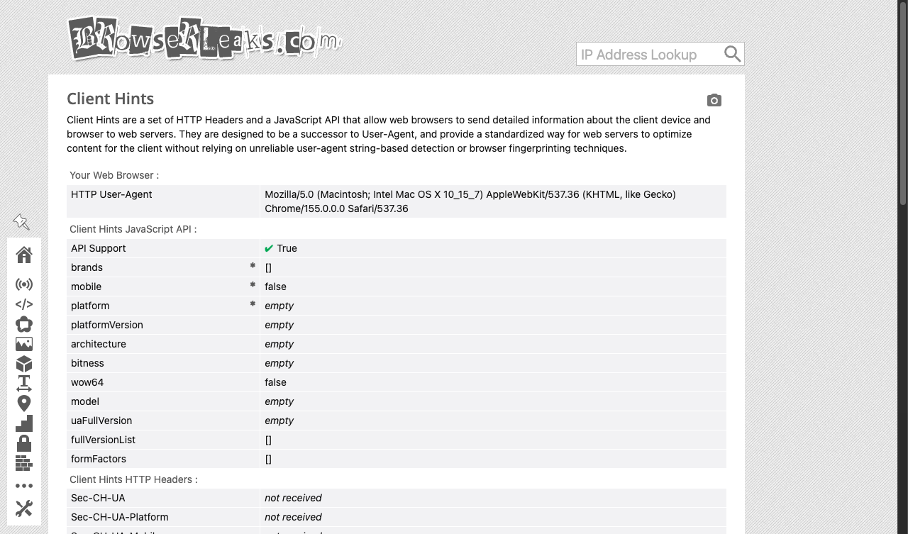
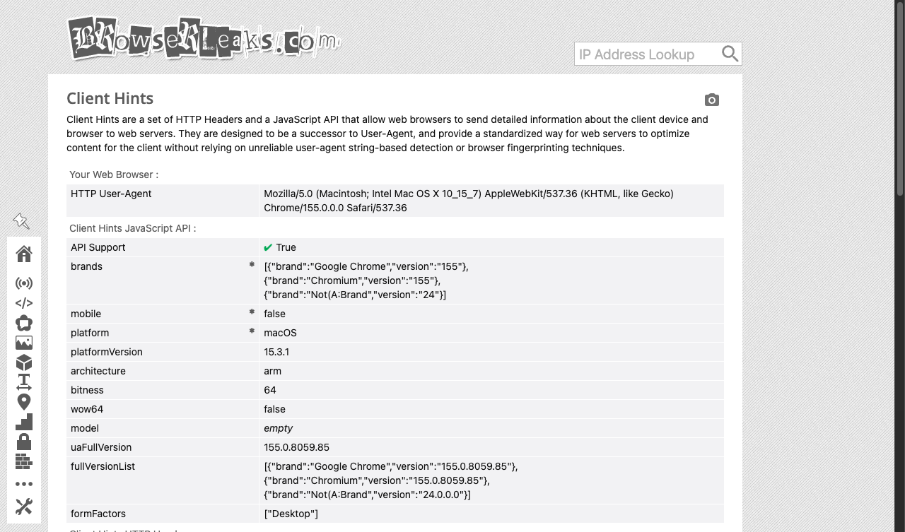
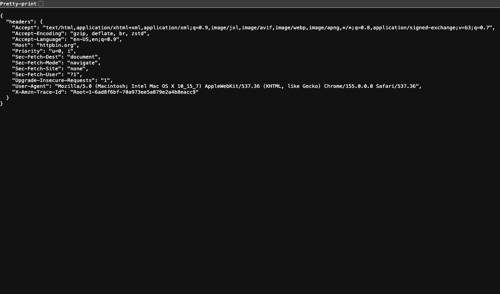
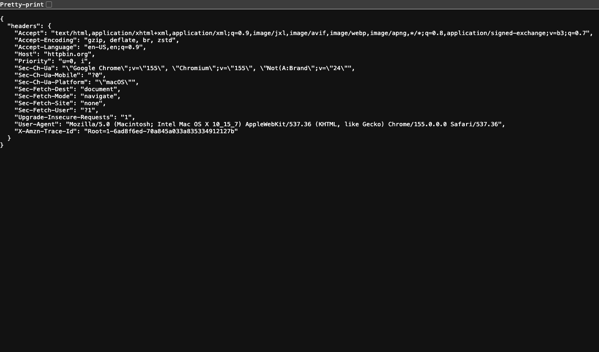
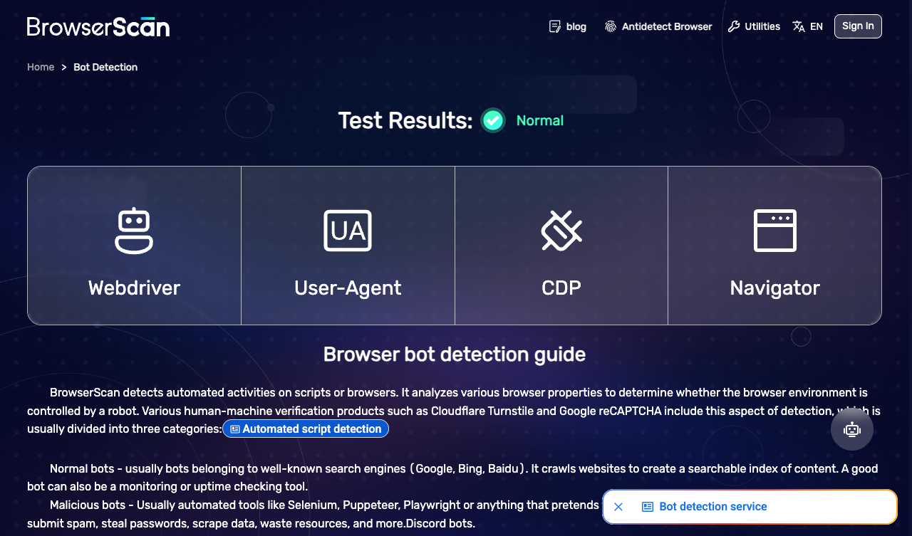
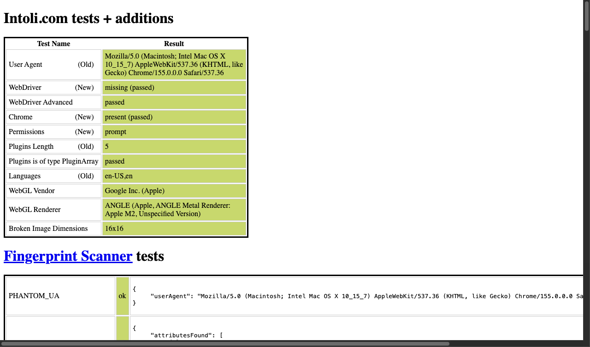
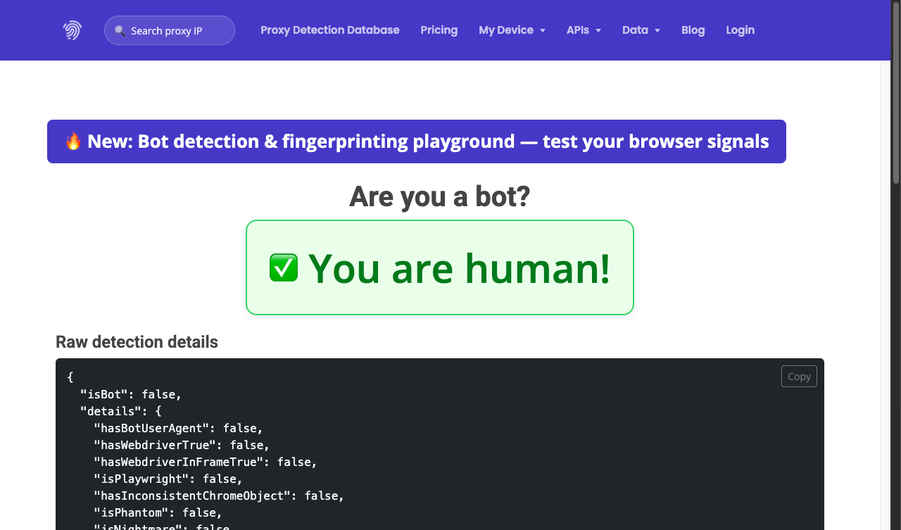

<div align="center">

```
      _____ _                         _               _
     / ____| |                       | |             | |
    | |    | |__  _ __ ___  _ __ ___ | |__  _   _  __| |_ __ __ _
    | |    | '_ \| '__/ _ \| '_ ` _ \| '_ \| | | |/ _` | '__/ _` |
    | |____| | | | | | (_) | | | | | | | | | |_| | (_| | | | (_| |
     \_____|_| |_|_|  \___/|_| |_| |_|_| |_|\__, |\__,_|_|  \__,_|
                                             __/ |
                                            |___/      🐉
```

**Cut one leak. Make sure two don't grow back.**

[](https://github.com/naimurhasan/chromhydra/actions/workflows/ci.yml)


</div>

Chromhydra is a small add-on for [SeleniumBase](https://github.com/seleniumbase/SeleniumBase) CDP Mode. It does two things:

1. **Fixes empty Client Hints.** When SeleniumBase overrides the user agent (always in headless mode, or whenever you pass `agent=`, `locale=` or `platform=`), Chrome drops `navigator.userAgentData` and stops sending `Sec-CH-UA` headers. Real Chrome never does that. Chromhydra sends matching Client Hints with every override.
2. **Ships `chromhydra doctor`.** It audits 11 "heads" of your browser fingerprint (page, worker, headers, GPU, IP) and tells you which ones disagree with each other.

## The bug, in one picture

Same Chrome 155, same machine, headless. Left is plain SeleniumBase 4.56.2, right is Chromhydra.

| SeleniumBase | Chromhydra |
|---|---|
|  |  |
| `brands: []`, platform empty | 3 brands, `macOS 15.3.1`, `arm`, full version list |
|  |  |
| no `Sec-Ch-Ua` header | `Sec-Ch-Ua`, `-Mobile`, `-Platform` present |

The Chromhydra values are byte-for-byte what a normal, headed Chrome 155 reports on the same Mac. The brand list (including the `Not(A:Brand` "GREASE" entry and its order) is computed with Chromium's own algorithm and is unit-tested against real Chrome 120, 124, 131 and 155.

## The doctor

```
$ chromhydra doctor --mode compare --ip

🐉 Chromhydra Doctor · SeleniumBase vs Chromhydra
   Check                       SeleniumBase     Chromhydra
────────────────────────────────────────────────────────────
   navigator.webdriver              ✅              ✅
   Headless marker                  ✅              ✅
   Client Hints                     ❌              ✅
   UA vs Client Hints OS           ⏭️              ✅
   Sec-CH-UA header                 ❌              ✅
   UA vs navigator.platform         ✅              ✅
   Header UA vs JS UA               ✅              ✅
   Accept-Language                  ✅              ✅
   Web Worker                       ✅              ✅
   WebGL GPU                        ✅              ✅
   IP vs timezone                   ✅              ✅

  SeleniumBase: 🩸 8/10 heads healthy
    Chromhydra: 🐉 all 11 heads healthy
```

It is just as useful when it says no. Here is a Mac pretending to be a Windows PC in New York:

```
$ chromhydra doctor --agent "...Windows NT 10.0..." --platform Win32 --timezone America/New_York --ip

✅ Client Hints               Google Chrome, Chromium, Not(A:Brand
✅ UA vs Client Hints OS      both say Windows
✅ Sec-CH-UA header           "Google Chrome";v="155", "Chromium";v="155", "Not(A:Brand";v="24"
❌ Web Worker                 worker disagrees on platform ('MacIntel' vs 'Win32')
                              ↳ fix: CDP can't override worker navigator.platform; keep your real OS or use a patched binary
❌ WebGL GPU                  GPU looks like macOS but UA says Windows
                              ↳ fix: A JS-level tool can't hide the GPU; keep your real OS or use a patched binary
❌ IP vs timezone             exit IP is in Asia/Dhaka (BD), browser says America/New_York
                              ↳ fix: Pass timezone="Asia/Dhaka"

🩸 8/11 heads healthy
```

### What the doctor checks

| Head | Leak it catches |
|---|---|
| `navigator.webdriver` | the classic automation flag |
| Headless marker | `Headless` in the UA, header, worker or brands |
| Client Hints | empty `navigator.userAgentData.brands` |
| UA vs Client Hints OS | UA says Windows, Client Hints say macOS |
| Sec-CH-UA header | HTTPS requests without `Sec-CH-UA`, or a wrong platform in it |
| UA vs navigator.platform | `Windows` UA with `MacIntel` platform |
| Header UA vs JS UA | the network and JavaScript disagree |
| Accept-Language | header language differs from `navigator.language` |
| Web Worker | a worker reports a different UA, platform, timezone, language or brands |
| WebGL GPU | an Apple GPU behind a Windows UA, or a software GPU (servers, VMs) |
| IP vs timezone | the exit IP's timezone differs from the browser's (`--ip`, uses ipinfo.io) |

## Honest scoreboard

Popular bot-check pages already pass plain SeleniumBase CDP Mode, and they still pass with Chromhydra. These screenshots are identical for both:

| BrowserScan | Sannysoft | DeviceAndBrowserInfo |
|---|---|---|
|  |  |  |

So Chromhydra doesn't claim to beat any of them. It fixes a consistency leak these pages don't look at, and gives you a tool to find the next one.

**What Chromhydra cannot fix**, and the doctor will tell you about:

- **Worker `navigator.platform`.** CDP has no override for it, so spoofing another OS shows up inside Web Workers.
- **The GPU.** WebGL reports your real graphics card.
- **Your IP.** Use a proxy and pass a matching `timezone=`.

The short version: keep your real OS and fix the rest. If you really need another OS, you need a patched browser binary, not a JavaScript-level tool.

## Install

```bash
pip install git+https://github.com/naimurhasan/chromhydra
```

## Use

```python
from chromhydra import Chrome

sb = Chrome("https://example.com", headless=True, locale="en-US")
print(sb.evaluate("navigator.userAgentData.brands"))
sb.driver.stop()
```

`Chrome` is SeleniumBase's `sb_cdp.Chrome` with the fix installed, so every SeleniumBase CDP method works as usual. You can also patch SeleniumBase in place:

```python
import chromhydra
from seleniumbase import sb_cdp

chromhydra.install()
sb = sb_cdp.Chrome("https://example.com", headless=True)
```

Audit your own setup, including a proxy:

```bash
chromhydra doctor --proxy user:pass@host:port --timezone Europe/Berlin --ip
chromhydra doctor --mode compare --json fingerprints.json --markdown report.md
```

## How it works

```
SeleniumBase Browser.get()
 └─ Connection.set_user_agent(ua, locale, platform)      ← Chromhydra swaps this one method
     ├─ Browser.getVersion          → real full version, e.g. 155.0.8059.85
     ├─ client_hints(ua, version)   → brands, GREASE, platform, version, arch   (pure function)
     └─ Network.setUserAgentOverride(ua, locale, platform, userAgentMetadata)
```

Everything that decides a value is a pure function in [`chromhydra/hints`](chromhydra/hints) and [`chromhydra/doctor/checks`](chromhydra/doctor/checks). The only side effects are launching Chrome and one patched method.

## Tests

```bash
pip install -e ".[dev]"
pytest                 # 64 unit tests, no browser, under a second
pytest -m browser      # launches real Chrome
```

CI runs the unit tests on Python 3.10, 3.12 and 3.13, then the browser tests, the doctor and the screenshot script on Ubuntu and macOS. Each run posts its doctor table to the job summary and uploads the screenshots as an artifact, so you can check the proof yourself instead of trusting mine.

## Roadmap

- [ ] Send the Client Hints fix upstream to SeleniumBase
- [ ] Optional patched-binary backend for cross-OS profiles
- [ ] `chromhydra doctor --html` report
- [ ] An example news crawler built on Chromhydra

## Credits

Built on [SeleniumBase](https://github.com/seleniumbase/SeleniumBase) by Michael Mintz (MIT). Chromhydra changes one method and adds a doctor; all the hard work is theirs.

Use it for testing, QA, research and automating sites you're allowed to automate. Respect `robots.txt` and terms of service.

MIT © 2026 Naimur Hasan
